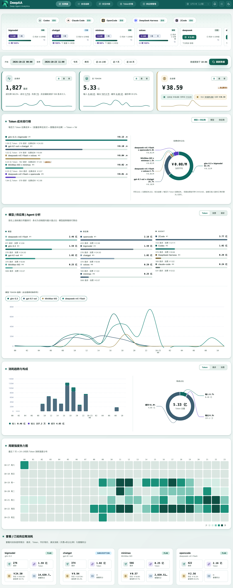
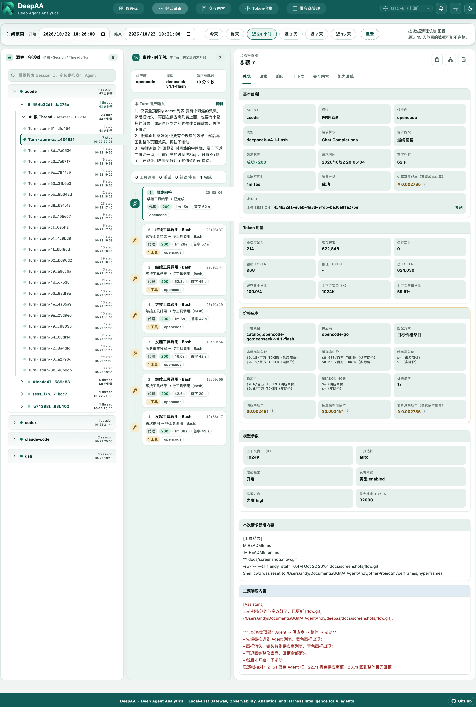
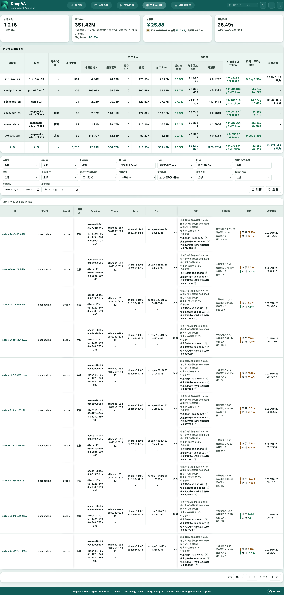
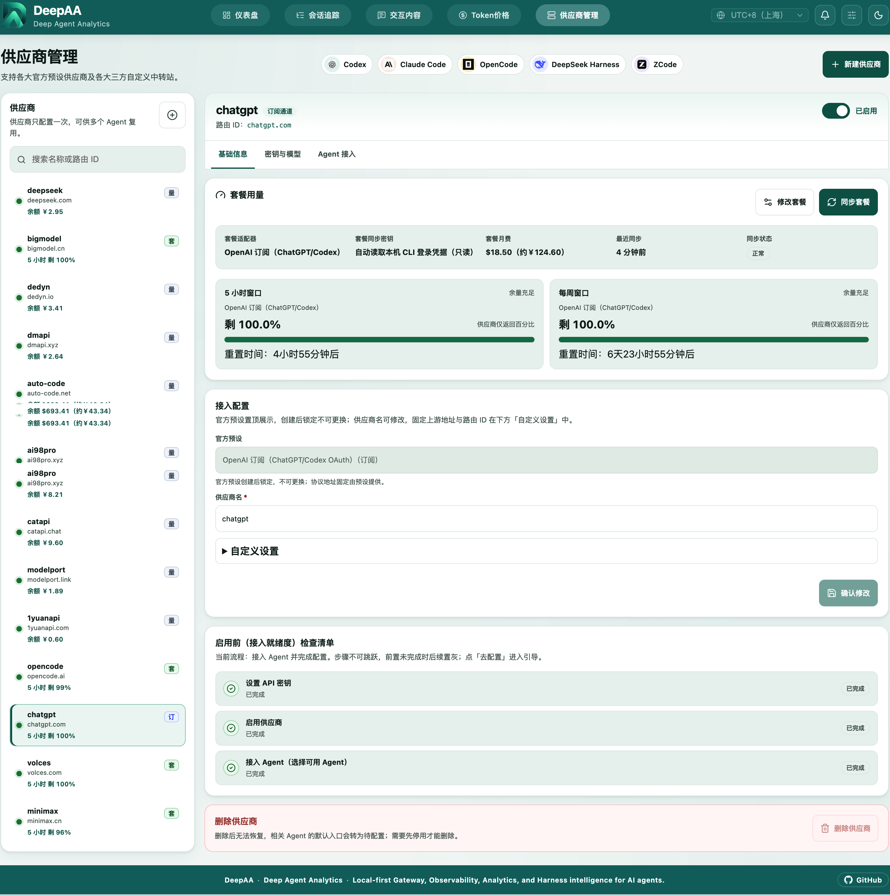

# DeepAA

**统一接入多家模型供应商，追踪 Agent 调用，看清用量与成本。**

DeepAA（Deep Agent Analytics）是开源免费、本地运行的 **AI Agent 网关与可观测分析工具**。它统一管理模型供应商、模型、密钥与 Agent 配置，追踪 Agent 与模型之间的调用链路，把用量、费用和计算依据关联到具体请求；支持配置模型故障转移，降低模型或通道异常对工作会话的影响。

[官网与产品预览](https://deepaa.dev/zh-CN) · [安装与接入指南](https://deepaa.dev/zh-CN/docs) · [English](./README_en.md) · [MIT 许可证](./LICENSE)

## 核心价值

使用多个 Agent、模型和供应商时，你需要知道：如何统一接入，一次任务调用了什么，以及消耗了多少、费用如何得出。DeepAA 把接入配置、调用记录与成本分析放到同一个本地工作台。

| 核心能力 | 你能得到什么 |
| --- | --- |
| **统一供应商与 Agent 接入** | 集中管理官方与中转站的模型服务、模型和密钥；启用配置同步后，在同一 Agent 中使用多家供应商的兼容模型，减少手动配置。 |
| **Agent 调用链路追踪** | 沿任务、子线程、轮次与步骤查看调用关系，将提示词、模型输出、工具交互、Token 和耗时关联起来。 |
| **上下文与能力证据** | 查看请求携带的工具、MCP、Skills 与规则注入，检查上下文构成估算、步间变化和压缩证据。 |
| **逐请求的成本透明** | 拆解输入、缓存读写与输出费用，查看单价、倍率、优惠规则和计算依据；按模型、供应商、Agent 与时间比较用量和成本。 |
| **供应商状态与规则更新** | 查看支持的供应商余额与套餐余量，了解已发布目录中的新模型，以及价格、套餐、活动与能力规则变更。 |
| **模型级故障转移** | 为模型配置有序备份链，在符合条件且尚未返回响应内容时切换可用模型，降低模型或通道异常对编码工作的影响。 |

当前已集成 **Codex、Claude Code、OpenCode、DeepSeek Harness、ZCode** 五种编码 Agent。可接入官方模型服务、套餐与订阅，以及聚合服务和自定义中转站；可用组合取决于协议、模型能力和 Agent 支持范围。

套餐与订阅的逐请求成本按照各供应商的积分折算公式严格估算（无明确积分折算公式的，使用套餐窗口周期用量按比例估算），支持的中转站可核对账单并补差。DeepAA 本身免费，模型服务按供应商规则计费。

观测及分析数据严格在本机保存，绝不上传 DeepAA 云端。

## 界面一览

**仪表盘** —— Agent 一键启动、供应商余额与套餐余量聚合统一查看、多维用量与成本及时准确分析。

<p align="center">
  
</p>

<table align="center">
  <tr>
    <td align="center" valign="top">
      <a href="docs/screenshots/sessions.png"></a>
      <br><br><sub><b>会话追踪</b> · Session → Thread → Turn → Step 调用链</sub>
    </td>
    <td align="center" valign="top">
      <a href="docs/screenshots/token-pricing.png"></a>
      <br><br><sub><b>Token 价格</b> · 逐请求费用与逐步计算公式</sub>
    </td>
    <td align="center" valign="top">
      <a href="docs/screenshots/proxy-management.png"></a>
      <br><br><sub><b>供应商管理</b> · 目标、密钥与模型、Agent 接入</sub>
    </td>
  </tr>
</table>

<p align="center"><sub>点击缩略图可查看大图</sub></p>

## 安装与运行

当前支持 **macOS 和 Windows**。

### 一键安装（推荐，无需克隆仓库）

```bash
# macOS（Terminal）
curl -fsSL https://deepaa.dev/install.sh | bash
```

```powershell
# Windows（PowerShell）
irm https://deepaa.dev/install.ps1 | iex
```

一键安装脚本会按需准备 Node.js，自动选择国内 npmmirror / 官方源中更快的下载渠道，通过 npm 安装 DeepAA 后启动服务，并打开控制台 `http://127.0.0.1:3210`。

### npm 安装

已经安装 Node.js 22.13+（23.x 需 23.4+）时，也可以直接安装（走国内还是官方镜像源，依赖用户自己环境配置）：

```bash
npm install -g deepaa
```

安装完成后自动启动并打开控制台（未自动打开时，可运行 `deepaa` 打开）。

### 源码安装

适合希望从源码运行或参与开发的用户，需要 Node.js 22.13+（23.x 需 23.4+）与 pnpm：

```bash
# 1. 克隆 GitHub 源码
git clone https://github.com/AIAgentAndy/DeepAA.git
cd DeepAA

# 2. 安装依赖
pnpm install

# 3. 构建生产版本
pnpm build

# 4. 启动并打开控制台
pnpm start
```

### 日常启动

一键或者npm安装的，电脑中可快捷搜索deepaa（对应图标位置：macOS的「应用程序」或 Windows「开始菜单」）打开控制台，也可以使用命令：

```bash
deepaa          # 启动服务并打开控制台
deepaa status   # 查看服务状态
deepaa stop     # 停止服务

deepaa service install # 注册系统服务——开机自启 + 崩溃自动恢复
```

源码安装的使用 `pnpm start` 启动。登录自启等更多运行方式见[官网文档](https://deepaa.dev/zh-CN/docs)。

## 启动后2步完成配置开始观测

请先准备好你要使用的 Agent 客户端，以及供应商 API 密钥或相应的订阅登录态。

### 第一步：添加供应商并接入 Agent

打开控制台的「供应商管理」，按照指引完成：

- **添加供应商**：DeepSeek、Openai等官方模型商选择官方预设；中转站等选择非官方预设并填写上游地址。
- **配置模型与凭据**：选择模型，录入 API 密钥；订阅通道按提示使用官方登录态即可。
- **接入 Agent**：选择要使用的 Agent，确认接入。

### 第二步：启动 Agent，开始工作

在仪表盘点击要使用的 Agent，通过快捷启动弹窗选择项目目录及所需供应商、模型或启动方式；也可以自行启动已完成配置的 Agent。订阅服务按界面提示使用对应的官方登录或官方模式。

随后在 Agent 中正常发起对话（选择 DeepAA 网关模型），DeepAA 会自动记录与分析已接入范围内的调用数据。需要查看时打开 `http://127.0.0.1:3210`：

- **仪表盘**：看供应商余额、套餐余量，以及用量与成本汇总。
- **会话追踪**：沿任务与步骤查看调用过程、上下文和工具交互。
- **交互内容**：查看提示词、模型输出与工具结果。
- **Token 价格**：查看每次请求的 Token、费用及计算依据。

## 更多文档

详细的 Agent 接入、计费口径、故障转移、数据管理、运行配置和问题排查，请查看[官网使用文档](https://deepaa.dev/zh-CN/docs)。

## 交流与反馈

[提交问题与建议](https://github.com/AIAgentAndy/DeepAA/issues)，或扫码加入 QQ 交流群：

<p align="center">
  
</p>
<p align="center"><sub>扫码加入 DeepAA QQ 交流群</sub></p>

## 作者

由 AIAgentAndy 创建与维护。

联系：AIAgentAndy001@gmail.com

## 许可证

[MIT](./LICENSE)
